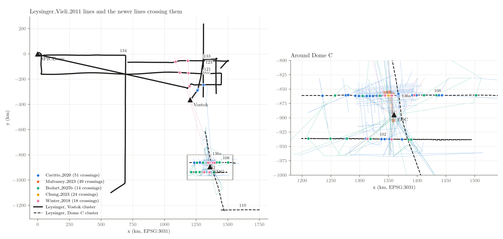
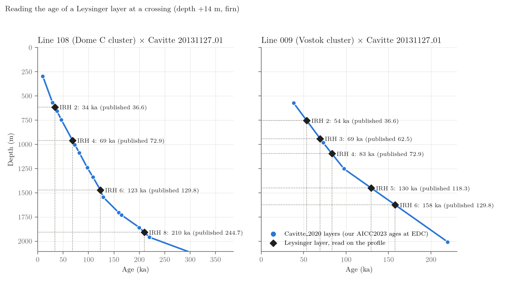
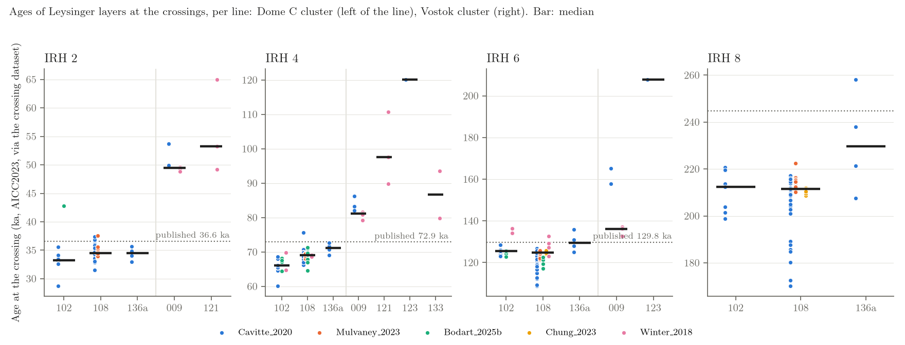
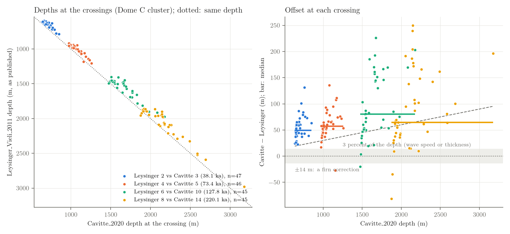
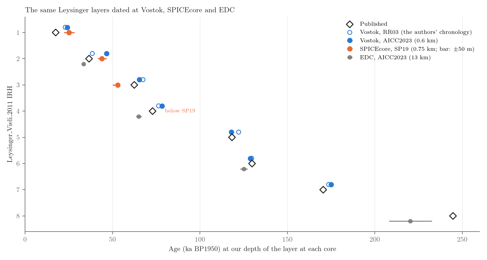
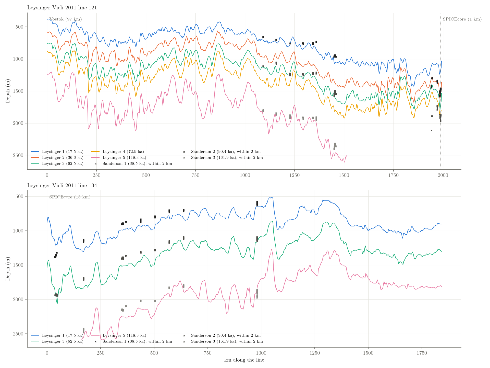
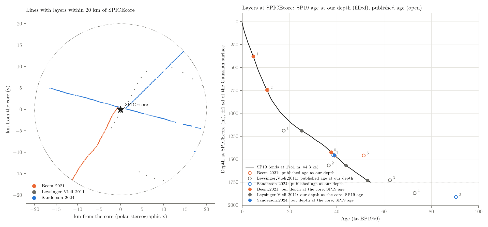
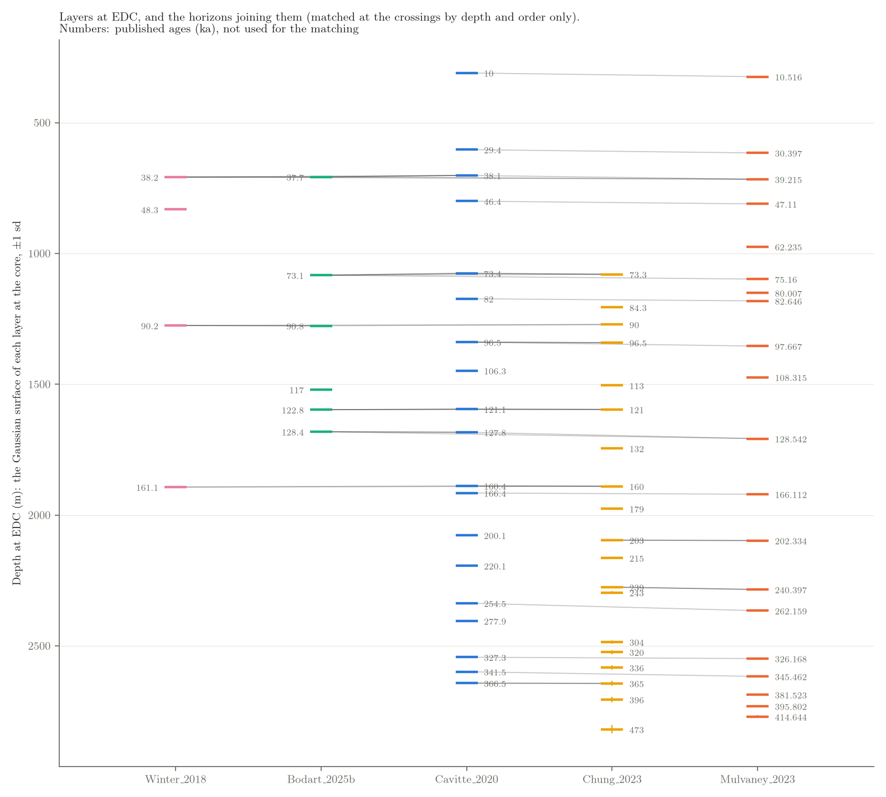
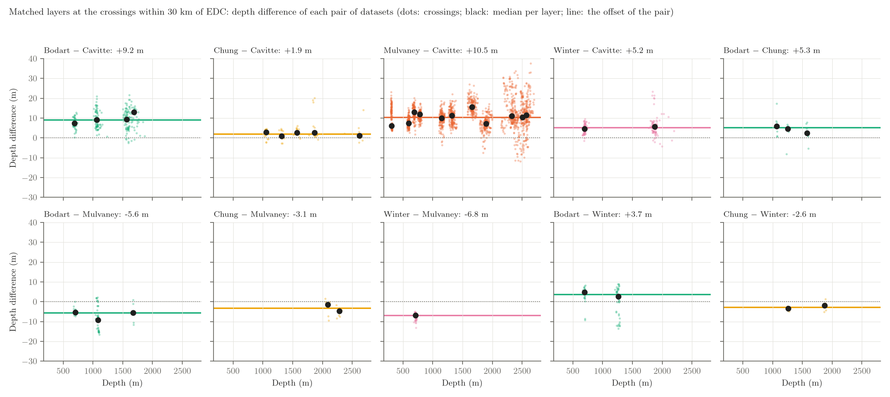
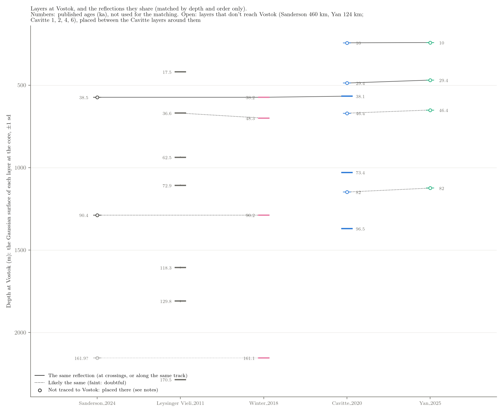

# Harmonisation: what we do, and what we find

The running record of the harmonisation (plan: `plan.md`, section 8c), written as we go. It is the source of the
methods and results of the manuscript, and of the section "Harmonisation" of the processing page of the website
(`/processing/`). Everything done to the data, every choice and every finding goes here, with its numbers, including
what did not work. The published values of the datasets are never changed; the harmonisation adds to them.

Input: the v2 build of 2026-11-21 (anta_json tag set on 2026-11-23). Code: `anta_database/harmonisation/`.

---

## H1. Ice-core positions

The ages of the layers come from ice cores, and a layer is tied to a core where the radar lines pass near it, so the
position of each core must be known to better than the distance between the radar traces near it (about 10 to 100 m).

**What we found.** The positions used so far came from two tables of the package that disagreed: the table of the
regions (`ice-core-coordinates.csv`) and the one of the 3D viewer. The first had errors of 20 to 38 km (Vostok, WAIS
Divide, Talos Dome); the second was closer, but rounded to 0.01° to 0.0001° for some cores (0.01° of latitude is about
1.1 km).

**What we did.** One table of the positions, from the primary sources (drilling and logging reports, the data records
of the cores), with its source and precision for each core, used everywhere in the database: the regions of the
queries, the 3D viewer, the submission form and the harmonisation.

**The table** (`anta_database/data/ice_cores.csv`, H1 done on 2026-11-22). "Moved": the distance from the position
used by the viewer before; precision: what the source allows, not a measured error.

| Core | Position | Source | Precision | Moved |
|---|---|---|---|---|
| EDC | 75.10162°S, 123.34820°E, 3233 m | The sign at the drill tent (photograph, personal communication) | ~10 m | 9 m |
| BELDC | 75°17'57.02"S, 122°26'42.5"E, 3230 m (WGS84) | Lilien et al. (2021) | ~10 m | 3 m |
| Dome Fuji | 77°19'01"S, 39°42'12"E, 3810 m | Dome-F Deep Coring Group (1998), DF1; DF2 is 43 m north | ~50 m | 85 m |
| Vostok | -78.46442, 106.83732, 3488 m | PANGAEA (AICC2012 Vostok) | ~300 m | 3 m |
| EDML | -75.0025, 0.0684, 2891.7 m (WGS84) | Wesche et al. (2007), GPS survey | ~10 m | 0 m |
| TALDICE | 72°49'40"S, 159°11'00"E, 2315 m | Frezzotti et al. (2004), Urbini et al. (2006), site ID1 | ~30 m | **1,230 m** |
| Taylor Dome | 77°47'47"S, 158°43'26"E, 2365 m | UW IsoLab | ~30 m | 1 m |
| Law Dome (DSS) | 66°46'11"S, 112°48'25"E | Jong et al. (2022) | ~30 m | **369 m** |
| SPICEcore | 89.9889°S, 98.1596°W, 2835 m | Casey et al. (2014) | ~50 m | 120 m |
| WDC | 79°28.0580'S, 112°05.1890'W, 1766 m (WGS84) | Fitzpatrick et al. (2014) | ~10 m | 75 m |
| Byrd | 80°01'S, 119°31'W, 1530 m | Ueda and Garfield (1969) | ~1 km | 4 m |
| Siple Dome | 81.65°S, 148.81°W, 621 m | Taylor et al. (2004) | ~2 km | 0 m |
| Skytrain | 79°44.46'S, 78°32.69'W, 784 m | Hoffmann et al. (2022) | ~20 m | 1 m |
| ABN | -71.166889, 111.366531, 2690 m | AADC, main hole of ABN1314 | ~10 m | **369 m** |
| RICE | -79.364, -161.706, 550 m | PANGAEA (Bertler et al., 2017) | ~110 m | **446 m** |
| Fletcher | 77°54.10'S, 82°36.30'W, 873 m | Mulvaney et al. (2014) | ~200 m | 216 m |
| Berkner | 79°32.90'S, 45°40.70'W, 890 m | Mulvaney et al. (2007) | ~200 m | 186 m |
| JRI | 64°12.10'S, 57°41.10'W, 1542 m | Mulvaney et al. (2014) | ~200 m | 4 m |

The old table of the regions was much further off: Talos Dome 37.6 km, Vostok 21.7 km, WAIS Divide 20.6 km.

**Pitfalls found in the sources**, worth a sentence in the manuscript:
- Some data records give another core's position under the same site name: the PANGAEA AICC2012 TALDICE event is the
  1996 firn core near the summit (-72.78333, 159.06667), not TALDICE; PANGAEA's Dome Fuji longitude is 39°40' instead of
  39°42' (0.8 km).
- Rounded values propagate: the 72°49'S of the TALDICE website (for 72°49'40"S) is 1.2 km north; the 0.01° of drilling
  reports and data centres is up to 1.1 km.
- No surveyed position of the borehole itself is published for EDC: the site selected for drilling (Stauffer et al.,
  2004) is 118 m from the borehole, and the camp (Vittuari et al., 2004) 60 m from that site. We use the position on the
  sign at the drill tent, given by a colleague from a photograph; it puts the Cavitte_2020 line 32 m from the core
  instead of 109 m. Nor is one published for Vostok 5G (station level) or DF2 (43 m from DF1). Byrd and Siple Dome are known to about 1 to 2 km only, which limits
  any tie there.

**The radar near the cores** (nearest point with a layer, v2 build, corrected positions): EDC: Winter_2018 30 m,
Cavitte_2020 30 m, Bodart_2025b 80 m, Mulvaney_2023 170 m, Chung_2023 190 m. BELDC: Cavitte_2020, Mulvaney_2023 20 m,
Chung_2023 40 m. Dome Fuji: Wang_2023 10 m, Franke_2025, Winter_2018, Bodart_2025a 120 m. Vostok: Winter_2018 70 m,
Cavitte_2020 80 m, Leysinger_Vieli_2011 600 m. EDML: Franke_2025, Winter_2018 150 m, Bodart_2025a 230 m. TALDICE:
Bodart_2025b 10 m. SPICEcore: Sanderson_2024 630 m, Leysinger_Vieli_2011 750 m, Beem_2021 810 m. WDC: Bodart_2021
520 m, Muldoon_2023 6.1 km. Byrd: Jacobel_2005 310 m, Muldoon_2023 940 m. ABN: Cavitte_2020 3.7 km. None within 20 km:
Taylor Dome, Law Dome, Siple Dome, Skytrain, RICE, Fletcher, Berkner, James Ross Island.

**Where the positions are used:** the regions of the queries (the places of the ice cores: Dome C, Little Dome C, Dome
Fuji, Vostok, Kohnen, Talos Dome, WAIS Divide, Siple Dome; WAIS Divide now has 8 lines instead of 9: the old table put the core 20.6 km north-east, at 79.28°S, 112.05°W, so two
Muldoon_2023 lines 33 and 46 km from that point, but 54 and 66 km from the core, left the 50 km circle, and one 41 km
from the core came in), the 3D viewer and
the submission form (`web/src/icecore-sites.ts`, checked against the table by `python -m
anta_database.harmonisation.cores`), and the harmonisation.

---

## H2. Chronologies

Every age of the harmonisation comes from a published depth-age table of an ice core. They come in many formats
(PANGAEA, NOAA, data papers), with ages before 1950 or 2000, in years or thousands of years, and with
uncertainties at 1 or 2 sigma or none at all.

**What we did.** One reader per published file (`anta_database/harmonisation/chronologies.py`). Each one gives the
same table: depth (m, on the depth scale of the core's log), ice age (ka before 1950), and uncertainty (ka, 1 sigma, NaN
where none is published). Every table is checked: the age must increase with depth. The source files are read where
they were downloaded, with their origin, and are not redistributed until their licences are checked (SP19 is
CC BY-NC). The tables are written to `~/data/isochrones/harmonisation/chronologies/<core>/<name>.csv`, with
`registry.json` (H2 done on 2026-11-22).

| Chronology | Core | Depth (m) | Age (ka) | Uncertainty | Source |
|---|---|---|---|---|---|
| **AICC2023** | EDC | 0-3193 | 0-813 | 1 σ | Bouchet et al. (2023), PANGAEA.961017 |
| **AICC2023** | EDML | 18-2416 | 0-145 | 1 σ | idem |
| **AICC2023** | TALDICE | 0-1597 | 0-492 | 1 σ | idem |
| **AICC2023** | Vostok | 0-3272 | 0-408 | 1 σ | idem |
| AICC2012 | EDC, EDML, TALDICE (to 207 ka), Vostok | | | none in these files | the AICC2012 column of the AICC2023 files |
| EDC3 | EDC | 0-3189 | 0-802 | none | Parrenin et al. (2007), NOAA |
| WD2014 | WDC | 0-3404 | 0-67.75 | 2 σ, halved | Buizert et al. (2015), Sigl et al. (2016), NOAA |
| SP19 | SPICEcore | 0-1751 | 0-54.3 | total, halved | Winski et al. (2019), USAP-DC 601206 |
| DF2021 | Dome Fuji | 0-2150 | 0-208 | 2 σ, halved | Oyabu et al. (2022), NIPR ADS |
| DFO-2006 | Dome Fuji | 0-2504 | 0-342 | none | Kawamura et al. (2007), NOAA (b2k, converted) |
| GT4 | Vostok | 0-3310 | 0-423 | none | Petit et al. (1999), NOAA |
| Byrd-BB2001 | Byrd | 940-2142 | 10-90 | none | Blunier and Brook (2001), NOAA (GISP2 scale) |
| Vostok-RR2003 | Vostok | 150-3165 | 6-349 | none | Ruddiman and Raymo (2003), NOAA: **our reconstruction** of the ice age (below) |
| AICC2023 | NGRIP | 8-3082 | 0-125 | 1 σ | Bouchet et al. (2023) |
| GICC05 | NGRIP | 7-2427 | 0-60 | maximum counting error, as 2 σ, halved | Svensson et al. (2008), NOAA |
| GICC05 | GRIP | 5-2097 | 0-32 | idem | idem |

The Greenland chronologies are there for reference: for the uncertainty of AICC2023 (below), and for Greenland
isochrones later. The Greenland cores are not in `ice_cores.csv` yet.

From WD2014 to AICC2023 we use the 395 volcanic ties between WDC and EDC of Bouchet et al. (2023), valid from 10 to
57 ka (`wd2014_to_aicc2023`). The difference AICC2023 − WD2014 is +65 years at 20 ka, −136 at 40 ka and −312 at 57 ka.

**How much the chronologies of a core differ** (age of the same depth, ka), i.e. what a change of scale alone does to
the age of a layer:

| | 500 m | 1000 m | 1500 m | 2000 m | 2500 m | 3000 m |
|---|---|---|---|---|---|---|
| EDC: AICC2012 − AICC2023 | +0.24 | +0.43 | −2.27 | +0.85 | +0.05 | −1.24 |
| EDC: EDC3 − AICC2023 | −0.33 | −0.67 | −1.49 | −1.64 | +0.15 | −1.50 |
| Vostok: GT4 − AICC2023 | −3.17 | +0.13 | −2.39 | −1.01 | +1.11 | −13.0 |
| Dome Fuji: DFO-2006 − DF2021 (300, 600, 1000, 1500, 2000 m) | +0.19 | −0.23 | −1.96 | +0.21 | −0.79 | |

**What we found, and what is still open:**
- **Over the last 60 ka, the uncertainty of AICC2023 is relative to the Greenland layer count.** Bouchet et al. (2023,
  section 2.1) hold NGRIP exactly to the layer-counted GICC05 by absolute tie points every metre over the last 60 kyr.
  So AICC2023 equals GICC05 at NGRIP within a year (checked: 35.087 ka at 2000 m in both), and its uncertainty there
  (17 years at 35 ka at NGRIP, 20 to 100 years at EDC between 30 and 50 ka) leaves out the counting error of GICC05
  (650 years at 35 ka and 1.25 ka at 58 ka, 1 σ). Bouchet et al. also recommend timescales tied to WD2014 over the last
  60 kyr. *Proposed:* for a layer younger than 60 ka, add the counting error of GICC05 at its age to the AICC2023
  uncertainty (in quadrature), and give its WD2014 age too (through the volcanic ties).
- **Leysinger Vieli et al. (2011) at Vostok.** The paper (paragraph 17) dates the Vostok layers with "the ages
  calculated by Ruddiman and Raymo [2003]". It uses Parrenin et al. (2007), i.e. EDC3, at EPICA, and there the layers
  are dated through the normalised depth on a line 13 km from the core. But Ruddiman and Raymo (2003) is a gas-age
  scale: their Table 1 has 33 tie points of depth and gas age, and no ice-age table is published. We reconstruct the
  ice age the way it was most likely done: their gas age at a depth (linear between the ties) plus the ice minus gas
  age of GT4 there (the delta age they started from). The steps of the GT4 delta age make the sum go back by up to
  50 years at 23 depths; we keep the running maximum. Between 1000 and 2000 m it is within 1.2 ka of GT4; it differs
  by −6.3 ka at 2500 m and +12.8 ka at 3000 m. If it doesn't give their published ages back in H3, we document it and
  leave the dating of that dataset to the AICC2023 ties of the other datasets.
- **AICC2012 uncertainties** are not in the AICC2023 files (Bazin et al., 2013 published them separately). They're only
  needed to compare with the papers that used AICC2012.
- **Depth scales.** DF2021 is on the DF1 depth (Oyabu et al., 2022: the age markers are given at "ice depth (m, DF1)",
  and those measured on DF2 or DF2001 are converted to DF1 depth). So are DFO-2006 and our position of Dome Fuji. At
  Vostok the record is a composite of several boreholes (3G, 4G, 5G, some hundreds of metres apart, matched by their
  depths); AICC2012 and AICC2023 don't say on which depth log, and the cores are within the precision of our position
  (300 m). The difference between the logs is a few metres at most, small next to the depth of a layer from the
  radar.
- **Not used by any dataset, not read:** EDML1, TALDICE-1, ST22, RICE17, Byrd-H1994, DFO-2006+AICC2012 (they're in
  `chronologies.json`). AICC2012 below 342 ka at Dome Fuji (Uemura et al., 2018) isn't read either; no layer is that
  deep there.

---

## H3. The depth of each layer at the cores (first pass, 2026-11-22)

**Method** (`anta_database/harmonisation/ties.py`). For one layer of one dataset at one core:
1. The points of the layer within 20 km of the core, as the median every 250 m along each line (at most 800 points
   per fit: all those within 3 km of the core, a random sample of the others).
2. A Gaussian process fitted to them, as a function of position. Its covariance is Matern 3/2, with a white noise; the
   length scale and the noise are fitted to the data. Its mean at the core is the depth there. Its standard deviation
   (without the noise of the single points) is the uncertainty: small where a line passes over the core, growing with
   the distance to the nearest line.
3. Two variants were tried: (a) the depth below the surface; (b) the fractional depth (depth ÷ ice thickness), times the ice
   thickness at the core, from a GP of the radar thickness of all datasets (EDC: 3219 ± 7 m).
4. **Leave one line out:** each line passing within 3 km of the core is removed in turn. The depth predicted at its
   point nearest to the core, from the other lines, is compared with its own depth there. That is the error the method
   makes where there is no line, as at a core no line crosses.
5. The age at that depth: (i) on the authors' chronology (raw_md.json of anta_json, "ice core" and "chronology"),
   which should give their published age back; (ii) on the reference chronology of the core (AICC2023 at EDC and
   Vostok, DF2021 at Dome Fuji). We also take the depth at which the authors' chronology gives the published age
   ("implied depth"): our depth minus that depth, Δz, says where we and the authors differ, in metres.

The depths are those of the v2 build, i.e. with the firn correction of each dataset (attribute `firn correction`);
Leysinger_Vieli_2011 has none.

**Results:** 104 ties: 72 at EDC, 14 at Vostok and 18 at Dome Fuji, from 9 datasets. Tables:
`~/data/isochrones/harmonisation/ties/ties.csv`, with one table per core and the points used.

*Depth or fractional depth?* The plain depth is better in 56 of the 60 layers that could be tested (with at least two
lines within 3 km). The median of the leave-one-line-out errors (rms per layer) is 2.7 m for the depth and 12.3 m for
the fractional depth: 3.1 m against 15.0 m at EDC, 1.9 against 2.0 at Vostok, and 2.4 against 3.9 at Dome Fuji. The
radar ice thickness is noisy along the lines (bed picks, and the thickness filled in from Bedmap), and dividing by it
brings that noise into the layer. **Decided (A, 2026-11-22): the depth only.** The fractional depth was removed from
the code; this comparison is its record. The uncertainty of the depth at the core
(GP) has a median of 1.6 m at EDC, 1.5 m at Vostok and 1.0 m at Dome Fuji.

*Do we get the published ages back?* Δz, our depth minus the depth implied by the published age, per dataset:

| Core | Dataset | Layers | Δz median (m) | Δz range (m) | Reading |
|---|---|---|---|---|---|
| EDC | Cavitte_2020 | 19 | +0.2 | −2.0 to +2.9 | **Reproduced**: ages within 0.2 ka (1 ka for IRH 16 and 19) |
| Dome Fuji | Wang_2023 | 7 | −0.7 | −12.5 to −0.3 | Reproduced, except IRH 6 (−12.5 m; its leave-one-line-out error is 15.6 m: a poorly traced layer) |
| Dome Fuji | Winter_2018 | 2 | −0.9 | −1.4 to −0.3 | Reproduced |
| EDC | Chung_2023 | 19 | +3.4 | −2.1 to +7.8 | Nearly constant: a different depth convention at the core? (one line, 260 m away) |
| EDC | Bodart_2025b | 6 | +5.7 | +0.5 to +10.6 | Their leave-one-line-out errors are 7 to 20 m: few lines, scattered near EDC |
| EDC | Winter_2018 | 4 | +6.8 | +0.6 to +11.8 | Not reproduced at EDC… |
| Vostok | Winter_2018 | 4 | +6.9 | +2.8 to +13.7 | …nor at Vostok: ages perhaps from both cores together |
| EDC | Mulvaney_2023 | 20 | +5.6 | +0.7 to **+28.8** | Grows with depth (0.67 % of the depth): a different wave speed? |
| Dome Fuji | Bodart_2025a | 1 | +19.2 | | Dated at EDML (AICC2023): a check of DFO-2006 at Dome Fuji, not a tie |
| EDC | Leysinger_Vieli_2011 | 4 | −80 | −113 to −39 | Their nearest line is 13 km away, dated by fractional depth, no firn correction |
| Vostok | Leysinger_Vieli_2011 | 7 | +53 | −6 to +84 | Not reproduced with RR03 (our ice age), GT4 or AICC2023: ±5 ka |

In ages: Mulvaney IRH 19 is 395.8 ka published, 405.9 ka at our depth on their AICC2012. Winter's 48 ka layer comes
out at 49.6 ka at EDC.

*Leysinger Vieli et al. (2011):* we can't reproduce their ages, at EDC or at Vostok, on any of the chronologies
(H2). At EDC their line is 13 km away and they dated it by fractional depth, and their depths have no firn correction.
At Vostok the line passes 600 m from the core, but the ages differ by up to 5 ka. Their dating stays as published,
documented. Their layers can be dated through the other datasets instead (below).

### Dating Leysinger_Vieli_2011 through the other datasets

Their lines are far from the cores, but they are crossed or passed by five datasets that we tied at EDC or Vostok
ourselves: Cavitte_2020, Mulvaney_2023, Bodart_2025b, Chung_2023 and Winter_2018. Some of these come within 5 to
270 m of their lines (`anta_database/harmonisation/transfer.py`). The steps:

1. At each point of their lines (about every 2.5 km), each layer of a reference dataset is interpolated by a Gaussian
   surface: its picks within 10 km, binned to 250 m along the lines, with the covariance found at the cores (Matern
   3/2, 8 km length scale, 2 m noise; not refitted at each point). Layers whose depth there is uncertain by more
   than 10 m are not used.
2. The reference layers at that point, with our AICC2023 ages from the ties (H3), make a local depth-age profile.
   A profile whose ages are out of order is not used.
3. The Leysinger layer gets its age from that profile, linear in depth between the two reference layers around it.
   Its depths are used as published (no firn correction), and shifted by +14 m as a test.

Ages (ka), median over all the points of all lines and all reference datasets (Cavitte, Mulvaney, Bodart, Chung),
16th to 84th percentile, with a +14 m firn shift:

| IRH | Published | Through the other datasets | Points |
|---|---|---|---|
| 2 | 36.6 | 35.4 (33.2 to 40.6) | 224 |
| 3 | 62.5 | 68.6 (66.7 to 71.3) | 32 |
| 4 | 72.9 | 69.3 (65.6 to 73.8) | 275 |
| 5 | 118.3 | 137.5 (131.6 to 138.4) | 14 |
| 6 | 129.8 | 122.7 (117.5 to 126.6) | 207 |
| 8 | 244.7 | 209.8 (198.8 to 216.6) | 116 |
| 9 | 352.4 | 299.7 (293.6 to 361.7) | 7 |

The firn shift changes the ages by 1 to 2 ka only.

**Line by line, the two clusters of the paper differ.** On the lines of their Dome C cluster (108, 136a, 102), up to
four reference datasets agree, within about ±3 ka along each line. IRH 2 is about 35 ka there, IRH 4 69, IRH 6 122,
and IRH 8 210 ka: younger than published at depth, as found at EDC (Δz of −39 to −113 m). On line 009, of their
Vostok cluster, the same IRHs 2, 4 and 6 come out at 53, 83 and 165 ka. The paper only *assumed* that three layers
(2, 4, 6 here) are the same in both clusters, from their ages at the two cores (Combined Cluster case, paragraph 18).
This does not support it: on 009 they look like deeper layers.

**Limits.** Most of their Vostok cluster (lines 121, 123, 133, 134, toward the South Pole) has dated data within 10 km
for only 0 to 19 % of its points (Beem_2021, Sanderson_2024, Yan_2025, none of them tied yet). Line 110 has none.
Next: the ties at SPICEcore (Beem, Sanderson), then the transfer again.

#### At the crossings themselves

The lines do cross: 156 crossings with the five newer datasets (Cavitte 51, Mulvaney 49, Chung 24, Winter 18,
Bodart_2025b 14), most of them on the Dome C cluster (figure). At a crossing no surface is needed: the layers of both
lines are interpolated along each line to the crossing point (the target's points are 2.5 km apart, the reference's
binned to 250 m), and the target layer is read on the depth-age profile of the reference layers there.

Figures: `docs/harmonisation/figures/leysinger.py`.

**Which dating is better?** For the Dome C cluster, with the +14 m firn shift (*superseded below: these depths are 50 to 60 m too shallow*):

| IRH | Published | At EDC, 13 km (H3) | At the crossings | Crossings (references) | Spread between crossings (1.4826 MAD) | Depth part of the EDC tie |
|---|---|---|---|---|---|---|
| 2 | 36.6 | 33.5 | 34.4 | 96 (3) | 0.9 ka | 0.7 ka |
| 4 | 72.9 | 65.1 | 69.0 | 115 (4) | 1.1 ka | 1.6 ka |
| 6 | 129.8 | 125.2 | 125.2 | 136 (5) | 1.6 ka | 2.0 ka |
| 8 | 244.7 | 220.4 | 211.6 | 118 (3) | 3.5 ka | 12.2 ka |
| 9 | 352.4 | | 306.6 | 4 (1) | 14.7 ka | |

The crossings agree with each other better than the EDC tie is known, and they agree with the surfaces of the transfer
above. The EDC tie rests on one line 13 km from the core, so its GP uncertainty is likely too small, too. **Proposed:
date such datasets at their crossings with datasets tied to a core, where they cross; through the surfaces of the
transfer where they only pass near; at the core only where neither exists.** The uncertainty of such an age is the
spread between the crossings, combined with the uncertainty of the reference datasets' own ages (their tie at the core
and the chronology), which is common to all their crossings, so it doesn't average out.

#### Same layers, 50 to 60 m shallower: matching by the sequence of layers

The ages above read the Leysinger depths on the Cavitte profile as they are. But are Leysinger's layers some of
Cavitte's, at another depth? Their published ages (36.6, 72.9, 129.8 ka) are close to those of Cavitte layers 3, 5 and
10 (38.1, 73.4, 127.8 ka).

*The spacing between layers*, which no common shift changes, says yes. At the crossings of the Dome C cluster, from
Leysinger 2 to 4 is 348 m and from Cavitte 3 to 5 is 357 m (ratio 0.989, 46 crossings); 4 to 6 against 5 to 10:
0.977; 6 to 8 against 10 to 14: 1.016. Over all the ordered choices of four Cavitte layers (the layers cannot cross),
the best match, with one common offset per crossing limited to ±120 m, is Cavitte 3, 5, 10, 14 (38.1, 73.4, 127.8,
220.1 ka), with Leysinger 59 m shallower (median). The two upper layers are unambiguous. For the deeper two, Cavitte 9
(121.1 ka) and 13 (200.1 ka) fit almost as well: the scatter of Leysinger's deep layers is too large.

*What the offset is not.* Cavitte minus Leysinger is 49 m for the 38 ka layer (sd 21 m, 47 crossings), 57 m for
73 ka (sd 27), 80 m for 128 ka (sd 64) and 65 m for 220 ka (sd 72).
- Not the firn: Leysinger has no firn correction, but that is about 14 m at Dome C.
- Not the wave speed: a wave speed error would grow in proportion to depth, and the spacings agree within 2 %.
- Not the ice thickness: Leysinger published normalised heights (raw file: "Normalised elevation layer"), and the
  depths in the database are (1 − normalised height) × their ice thickness (the raw column "Bed elevation" is a
  thickness). Their thickness is 42 m less than Cavitte's at the crossings (sd 67 m), but rebuilding their depths with
  Cavitte's thickness doesn't reduce the offset or its scatter (38 ± 26 m for the 38 ka layer).
- What it is: a mostly constant shift, and a scatter of 20 to 70 m from crossing to crossing. Both are within the
  error the paper gives for its layers, 0.02 to 0.03 of the normalised height, i.e. 65 to 100 m at Dome C (auxiliary
  material, section 3, "Sources of data error": a rough worst case for the drift of a pick between layers). Navigation of the 1970s flights adds to it.

**So the 38 ka layer is there.** Leysinger IRH 2 is Cavitte's 38.1 ka layer, and IRH 4 its 73.4 ka layer. IRH 6 and 8
are probably 127.8 and 220.1 ka, or the layers just above. **The ages read on the depth alone (34.4, 69.0, 125.2,
211.6 ka in the table above) are biased young by the 50 to 60 m shift, and are superseded.** For a dataset whose
depths are much less accurate than those of the newer ones, the layers must be matched by their sequence (order and
spacing), not by depth: the "spacing fingerprint" of section 3.3 of the plan. It becomes the method of H5 for such
datasets; the depth reading remains for datasets of comparable accuracy.

**The Vostok cluster.** Line 009 crosses Cavitte only 3 times near Vostok, and no choice of Cavitte layers matches its
layers with a common offset (145 m rms). The depth reading put its IRH 2, 4, 6 12 to 15 ka older than on the Dome C
cluster. Those depths are 110 to 150 m *below* the Cavitte layers of the same published ages, where the Dome C cluster
is 50 to 60 m *above*. That difference, 160 to 210 m, is larger than the paper's own error, which suggests that the
layers the paper correlated between its two clusters (Combined Cluster case, paragraph 18, through their ice-core ages
only) are not the same. With three crossings this is not established. To be tested with the ties at SPICEcore and the
datasets crossing the rest of that cluster (Beem_2021, Sanderson_2024, Yan_2025).

**For the manuscript:** (1) a dataset of the 1970s, dated in 2011 by fractional depth 13 km from EDC, is matched
through 47 crossings with a dataset of today to the layers of known age: its 36.6 ka layer is the 38 ka layer seen in
every EAIS dataset. (2) Its depths are 50 to 60 m too shallow, within its stated error: matching by the sequence of
layers works where matching by depth fails. (3) The correlation of its two clusters, assumed in 2011, looks wrong;
the newer datasets make it testable.

**Proposed for the database age of their layers:** on the Dome C cluster, the ages of the Cavitte layers they
match (38.1 and 73.4 ka; 127.8 and 220.1 ka marked uncertain), on AICC2023 through our tie of Cavitte at EDC. On the
Vostok cluster, none yet. The published ages stay as published.

*Across cores:* Cavitte's layers, dated at EDC, reach Vostok too. There, AICC2023 gives 37.7, 72.8 and 97.6 ka for
the layers published at 38.1, 73.4 and 96.5 ka. That is the first test of carrying a layer from one core to another
(H5).

### SPICEcore (2026-11-23)

The same method at SPICEcore, on SP19 (Winski et al., 2019), which reaches 1751 m (54.3 ka):
`core_ties("SPICEcore")` → `ties_SPICEcore.csv` (kept out of `ties.csv` for now). Three datasets have lines within
20 km: Sanderson_2024 (two lines crossing 0.8 km from the core), Beem_2021 (one line, 0.8 km) and Leysinger_Vieli_2011
(sparse points, 0.75 km).

| Dataset | IRH | Published (ka) | Our depth (m) | Leave-one-line-out (m) | SP19 at our depth (ka) |
|---|---|---|---|---|---|
| Sanderson_2024 | 1 | 38.5 ± 2.2 | 1456 ± 11 | 28 | 39.0 ± 0.3 (depth: ± 0.4) |
| Sanderson_2024 | 2 | 90.4 ± 3.6 | 1913 ± 10 | 30 | below SP19 |
| Sanderson_2024 | 3 | 161.9 ± 6.8 | no line within 20 km | | |
| Beem_2021 | 1 | 4.7 | 379 ± 3 | | 4.6 |
| Beem_2021 | 2 | 10.7 | 746 ± 13 | | 10.4 |
| Beem_2021 | 5 | 37.6 | 1426 ± 19 | | 37.7 |
| Beem_2021 | 6 | 51.4 | 1460 ± 23 | | 39.2 |

- **Sanderson's 38.5 ka layer is reproduced** on SP19 (39.0 ka, within its ±2.2 ka). The depth is less sure than
  at EDC (two lines only: leave-one-line-out 28 m, about ±1 ka here). Its 90.4 ka layer is 160 m below the bottom of
  SPICEcore: its age can only come from Vostok and EDC, through Winter_2018 (the ladder, H5), as the authors did.
- **Beem_2021** IRH 1, 2 and 5 are reproduced (one line, no firn correction). IRH 6 (51.4 ka) is only 34 m below
  IRH 5 at the core and SP19 gives it 39.2 ka: not reproduced, to look at (its single line, or the layers merging near
  the core).
- Sanderson IRH 1 and Beem IRH 5 are probably the same 38 ka reflection: 30 m apart at the core, within their sd
  (11 and 19 m) and Beem's missing firn correction (about 12 m). To check at their crossings.
- **Leysinger_Vieli_2011** is not reproduced here either (17.5 ka published, 25 ka on SP19 at our depth; its points are
  sparse, from normalised heights). Compared with Vostok below.

**Leysinger_Vieli_2011 at Vostok and SPICEcore.** Its lines reach both cores (0.6 and 0.75 km), so the same layer can
be dated twice, each time on the core's own chronology:

| IRH | Published (ka) | Vostok depth (m) | Vostok AICC2023 (ka) | Vostok RR03 (ka) | SPICEcore depth (m) | SPICEcore SP19 (ka) |
|---|---|---|---|---|---|---|
| 1 | 17.5 | 419 ± 2 | 24.2 | 23.0 | 1189 | 25.2 (22.3 to 28.3) |
| 2 | 36.6 | 669 ± 3 | 46.7 | 38.4 | 1568 | 43.9 (41.6 to 46.7) |
| 3 | 62.5 | 937 ± 4 | 65.4 | 67.5 | 1730 | 53.0 (50.1 to 54.3) |
| 4 | 72.9 | 1108 ± 4 | 78.4 | 76.4 | 1870 | below SP19 (1751 m) |

The SPICEcore range is ±50 m of depth: within 5 km of the core, Leysinger's line 121 jumps by 50 to 100 m from point
to point, and its line 134 (15 km away) is 250 m shallower for IRH 1, so the depth of the Gaussian surface there
(± 13 to 16 m) is too optimistic (leave-one-line-out 224 to 334 m).

- **IRH 1 and 2 agree between the cores** (24.2 against 25.2 ka; 46.7 against 43.9 ka, within the SPICEcore range),
  and both disagree with the published 17.5 and 36.6 ka: in the Vostok cluster, Leysinger's layers are older than
  published. In the Dome C cluster, IRH 2 is Cavitte's 38.1 ka layer (H3 above), so 44 to 47 ka here is another,
  older layer: one more sign that the two clusters' IRH 2 are not the same reflection.
- **IRH 3 does not agree** (65.4 against 53.0 ka): at SPICEcore it is 20 m above the bottom of SP19, where the
  scatter of line 121 matters most.
- **At Vostok, RR03 and AICC2023 differ by up to 8 ka between 600 and 750 m** (38.4 against 46.7 ka at 669 m for
  IRH 2); AICC2012 is the same as AICC2023 there, GT4 in between. RR03 (gas age + the GT4 delta age, H2) gives back the
  published 36.6 ka for IRH 2 within 2 ka: part of the published ages comes from the chronology, not the layers.
- Only Leysinger links Vostok and SPICEcore directly. The 38 ka layer links them otherwise: Sanderson at SPICEcore
  (39.0 ka on SP19) and Winter or Cavitte at Vostok, through Winter's lines. To check: is Leysinger IRH 2 that layer
  (46.7 and 43.9 ka here, older)?

Figure: `docs/harmonisation/figures/leysinger_cores.py`.

**Is Leysinger IRH 1 (17.5 ka) Sanderson's 38.5 ka layer?** (2026-11-23) Probably not, but it can't be excluded.
- *For:* Leysinger's lines 121 and 134 run between SPICEcore and Vostok, with Sanderson lines within 2 km at 23
  places. Away from SPICEcore, Sanderson 1, 2, 3 (38.5, 90.4, 161.9 ka) sit near Leysinger 1, 3, 5, in sequence,
  Leysinger 0 to 140 m deeper (5 to 10 percent). With Leysinger's depth errors (below), that is within its error.
- *Against:* near Vostok, Leysinger line 009 can be compared with Winter and Cavitte, whose depths agree with the ice
  core: Cavitte's 38.1 ka layer is 114 m below Leysinger 1 (MAD 20 m, 96 points over 109 km), Winter's 38.2 ka 145 m
  below it (MAD 9 m). Leysinger 2 is Winter's 48.3 ka layer (20 m apart, MAD 9 m), as the age of IRH 2 on AICC2023 at
  Vostok (46.7 ka) says. For Leysinger 1 to be the 38 ka layer, line 009 would be about 25 percent too shallow near
  Vostok (three times its offset at Dome C), and its IRH 2 would not fall on the 48 ka layer.
- *Leysinger against itself:* lines 009 and 121 cross 225 km from Vostok (93 m apart), with almost the same ice
  thickness (3071 and 3000 m), but line 121 puts every layer 12 to 19 percent deeper (IRH 1: 657 against 565 m). So the
  normalised heights of its lines don't agree, or the IRH numbers change between lines. Within 50 km of SPICEcore,
  line 121's layers jump and cross; there Sanderson 1 falls near Leysinger 2, not 1.
- *So:* depth alone can't decide on lines 121 and 134, and the IRH numbers of Leysinger may not mean the same layer
  on all its lines. Near Vostok, where the other datasets are dense, Leysinger 1 is a younger layer (about 24 ka on
  AICC2023) and Leysinger 2 the 48 ka layer, not the 38 ka one. That differs from the Dome C cluster, where Leysinger 2
  is Cavitte's 38.1 ka layer: Leysinger's IRH numbers don't follow one reflection across its survey.

Figure: `docs/harmonisation/figures/leysinger_sanderson.py`.

Figure: `docs/harmonisation/figures/spicecore.py`.

**Sanderson_2024 and EDC.** Sanderson has no line near EDC (859 km); it crosses only Winter_2018 (4,227 crossings,
mostly where its line A11 runs along Winter's 099046st10, the same flight). Point by point along it (within 300 m):
38.5 ka = Winter's 38.2 ka (68 percent of the points within 20 m, median 0.3 m), 90.4 ka likely Winter's 90.2 ka (37
percent), 161.9 ka doubtful (8 percent: over 180 km the two follow different reflections, up to 200 m apart). In the
EDC ladder (H5), its layers are drawn at the depth of the Winter layer they follow. So Sanderson's 38 ka layer joins
SPICEcore to EDC through Winter: the first link between the two cores.

**Still to do in H3:**
- Ages on AICC2023 with their full uncertainty: the chronology, the depth, and the GICC05 counting error below 60 ka
  (H2).
- The other cores (EDML, TALDICE, BELDC, WDC, Byrd).
- The answers to anta_json #18 to #21 (Winter, Chung, Bodart_2025b, Mulvaney).

---

## Datasets that cause problems (running list)

Kept here as we go, so that each is handled on purpose in H5 and stated in the manuscript.

| Dataset | Problem | Found | Handling for now |
|---|---|---|---|
| Leysinger_Vieli_2011 | Depths from normalised heights times a thickness; 50 to 60 m shallower than the newer datasets at the crossings, scatter 20 to 70 m (within its stated error of 0.02 to 0.03 of the thickness). Line 13 km from EDC; ages not reproduced at EDC or Vostok. Its two clusters probably don't share the layers the paper correlated | H3, 2026-11-22 | Matched by the sequence of its layers, not by depth; dated through the matched Cavitte layers (Dome C cluster only) |
| Mulvaney_2023 | Published ages not reproduced at EDC (Δz growing with depth, up to 29 m); at the crossings 10.5 m deeper than Cavitte, with a large scatter below 2000 m; its 75.2 ka layer sits 21 m below Cavitte's 73.4 ka (usual: 10.5 m) | H3 and below | Anta_json issue on Monday; its deep layers and the 75 ka link marked uncertain |
| Bodart_2025b | Few lines near EDC, leave-one-line-out errors 7 to 20 m; its 128 ka layer at the core 15 to 21 m off the crossings | H3 and below | Anta_json issue on Monday; matched at the crossings rather than at the core |
| Wang_2023, IRH 6 | Leave-one-line-out error 15.6 m at Dome Fuji; age not reproduced (−12.5 m) | H3 | Marked uncertain |

---

## H5, first look: the same reflections across the datasets at EDC (2026-11-22)

Can we already say which layers of the datasets near EDC are the same reflection? Five datasets have layers within
30 km of the core: Cavitte_2020 (25 layers), Mulvaney_2023 (20), Chung_2023 (19), Bodart_2025b (6), Winter_2018 (4).
Script: `docs/harmonisation/scripts/edc_horizons.py`; outputs `crossings_EDC.parquet`, `matches_EDC.csv`,
`horizons_EDC.csv` next to `ties.csv`.

**Method.**
1. All the crossings of every pair of these datasets within 30 km of EDC: 648 in all, from 8 (Chung with Winter or
   Bodart, its one line) to 192 (Cavitte with Mulvaney). Some pairs of lines cross many times: they fly nearly the
   same track (e.g. one Cavitte and one Mulvaney line, 103 times).
2. For each pair of layers, the median depth difference over the crossings, and its spread.
3. For each pair of datasets, one offset (the median of the closest pairs of layers), then each layer matched to the
   layer of the other dataset nearest that offset: within 5 m (or twice the spread), spread at most 10 m, at least 3
   crossings, the order of the layers kept.
4. The matched pairs joined into horizons across datasets.

Only depth and order are used. **The published ages are kept aside, as an independent check.**

**Results.** 35 matched pairs make **18 horizons**, none with two layers of the same dataset. The published ages of
their members agree within 0.2 to 2.1 ka for 16 of them, though the matching never saw them:

| Depth at EDC (m) | Cavitte | Mulvaney | Bodart_2025b | Winter | Chung | AICC2023 (our tie of Cavitte) | Spread of our ties |
|---|---|---|---|---|---|---|---|
| 317 | 10.0 | 10.5 | | | | 10.0 | 0.5 |
| 609 | 29.4 | 30.4 | | | | 29.3 | 1.2 |
| **707** | **38.1** | **39.2** | **37.7** | **38.2** | | **38.1** | 1.1 |
| 805 | 46.4 | 47.1 | | | | 46.7 | 0.9 |
| 1081 | 73.4 | 75.2 (?) | 73.1 | | 73.3 | 73.0 | 2.1 |
| 1177 | 82.0 | 82.6 | | | | 82.0 | 0.7 |
| 1275 | | | 90.8 | 90.2 | 90.0 | (91.0 to 91.5) | 0.5 |
| 1341 | 96.5 | 97.7 | | | 96.5 | 97.5 | 1.6 |
| 1596 | 121.1 | | 122.8 | | 121.0 | 122.9 | 0.2 |
| 1683 | 127.8 | 128.5 | 128.4 | | | 128.8 | 1.6 |
| 1890 | 160.4 | | | 161.1 | 160.0 | 159.6 | 0.8 |
| 1918 | 166.4 | 166.1 | | | | 164.8 | 1.0 |
| 2096 | | 202.3 | | | 203.0 | (202.7 to 203.0) | 0.3 |
| 2280 | | 240.4 | | | 239.0 | (240.1 to 241.7) | 1.6 |
| 2351 | 254.5 | **262.2** | | | | 253.2 | **10.4** |
| 2546 | 327.3 | 326.2 | | | | 326.5 | 1.4 |
| 2607 | 341.5 | **345.5** | | | | 340.5 | **10.3** |
| 2643 | 366.5 | | | | 365.0 | 366.7 | 0.7 |

The 38 ka layer is one reflection in four datasets. In two horizons the same reflection has published ages 4 and
7.7 ka apart (Mulvaney's 262.2 and 345.5 ka against Cavitte's 254.5 and 341.5): the reconciliation gives them one
age. "(?)": the link of Mulvaney's 75.2 ka layer is indirect (through Bodart and Chung); against Cavitte it is 21 m
deeper than their usual offset, so it may be another layer about 10 m below.

Leysinger_Vieli_2011 is in the figure too, matched to Cavitte by the sequence of its layers (H3), not by the
crossings: its depths at the core come from a line 13 km away (sd 8 to 44 m).

**Mulvaney, H3 and H5 together (2026-11-23).** H3 reproduces Mulvaney's ages from its own depths within 3.5 m down to
IRH 9 (98 ka), and H5 finds its layers 10.5 m deeper than Cavitte's: no contradiction. Mulvaney dated its layers at
its own depths, which are about 10 to 15 m deeper than Cavitte's for the same reflection (at the core and at the
crossings), so the same reflection gets an older age (39.2 against 38.1 ka, up to 262.2 against 254.5 ka). Below
IRH 9 its ages also drift from its depths (to +29 m). Asked in anta_json #21; Winter #18, Chung #19, Bodart_2025b #20.

**Depth offsets between datasets** (the second dataset deeper, m): Mulvaney − Cavitte +10.5, Bodart − Cavitte +9.2,
Winter − Cavitte +5.2, Chung − Cavitte +1.9, and so on. They are about **constant with depth** in every pair (figure):
a shift, from the firn correction or the pick of the surface, not a wave-speed scale. They don't follow the firn
corrections given (Cavitte +14.6 m, added by us; Mulvaney and Chung 10 m; Winter 13 m; Bodart 9.5 and 14.6 m): with
those, Mulvaney should be about 4.6 m *shallower* than Cavitte, not 10.5 m deeper. To be understood in H4, with the
metadata of each radar. The loops of three datasets close within ±2.6 m, except those through the pair Mulvaney and
Chung (−5.5 to −7.9 m; their 8 crossings are on deep layers only).

**The core and the crossings agree.** For the matched pairs, the depth difference at the core (Gaussian surfaces, H3)
and at the crossings differ by 1.7 m (median). The exceptions are the deep Mulvaney layers (up to 18 m) and Bodart's
128 ka layer (15 to 21 m), where their lines near the core are few or scattered.

**What it means for the dating.** The datasets near EDC can be reconciled now: one horizon per reflection, its age
taken once, at the core. The proposed age of each horizon is our AICC2023 age at the core from the dataset that
reproduces its own published ages and passes closest (Cavitte_2020, 130 m from the core, 19 layers within 3 m),
or the next best where Cavitte doesn't have the layer. The spread of the ages between the members (0.2 to 2 ka) is
mostly the depth offsets between datasets; the depth scale (which dataset's depth is right at the core, i.e. the
offsets of H4) decides the final ages. Still to do: the same at Vostok and Dome Fuji, then join the three through
the datasets that reach two of them (Winter, Cavitte: the 38 ka layer).

---

## H5 at Vostok: the same reflections, with Sanderson and Yan (2026-11-23)

Only Winter_2018 (IRH 1-4, 0.1 km), Cavitte_2020 (3, 5, 7; one line, 0.1 km) and Leysinger_Vieli_2011 (1-7, line 009,
0.6 km) reach the core. Two more datasets join through them: Sanderson_2024 (460 km away) through Winter, along the
same flight (SPICEcore above), and Yan_2025 (124 km away) through Cavitte: Yan's line `20131127_01` runs along a
Cavitte line (60 m apart). Its other 30 lines (LSE, PEL) are 500 to 800 km from any Cavitte line; only R42a passes
22 km from one. So Yan 1-9 (6.5 to 23.5 ka, modelled) and 12, 14, 16 (38.1, 73.4, 96.5 ka) never meet Cavitte and
are not in the ladder.

**Placing the layers that don't reach Vostok.** On the shared track, each layer is carried to Vostok by its position
between the two Cavitte layers tied at Vostok just above and below it at the same point (the surface above Cavitte 3),
linear in depth, median over the points. Checked on Cavitte's own layers 1, 2, 4, 6, which don't reach Vostok: placed
at 243, 487, 670 and 1148 m, AICC2023 there gives 10.9, 31.1, 46.7 and 81.4 ka (published 10.0, 29.4, 46.4, 82.0).

| Pair | Layers | Difference (m) | How |
|---|---|---|---|
| Cavitte − Winter | 38.1 = 38.2 ka | 6.1 (MAD 0.9, 9 crossings) | crossings within 30 km |
| Leysinger − Winter | Leysinger 2 (36.6) = 48.3 ka | −19.9 (MAD 8.9, 78 points) | points within 1 km, line 009; likely |
| Yan − Cavitte | Yan 10 = Cavitte 1 (10.0 ka) | +5.3 (MAD 5.0, 673 points) | same track, within 300 m |
| Yan − Cavitte | Yan 11 = Cavitte 2 (29.4 ka) | −15.9 (MAD 1.5, 656 points) | same track |
| Yan − Cavitte | Yan 13 = Cavitte 4 (46.4 ka) | −19 (placed at Vostok) | likely: Cavitte has no IRH 4 where Yan has 13 |
| Yan − Cavitte | Yan 15 = Cavitte 6 (82.0 ka) | −24 (placed at Vostok) | likely: same |
| Sanderson → Winter | 38.5 = 38.2; 90.4 = 90.2; 161.9 = 161.1 ka | | sure; likely; doubtful (SPICEcore above) |

- **The 38 ka layer joins three datasets at Vostok:** Sanderson, Winter and Cavitte; at EDC, Cavitte and Winter join it
  to Mulvaney and Bodart_2025b (EDC ladder). With Sanderson at SPICEcore (39.0 ka on SP19), it is one reflection
  from EDC to Vostok to SPICEcore.
- **Yan is about 16 to 24 m shallower than Cavitte** for 29.4, 46.4 and 82 ka, with a very small scatter for 29.4 ka
  (1.5 m over 656 points, so the same radargrams). Cavitte has +14.6 m of firn correction added by us; Yan's firn
  correction is "unknown" (anta_json #13). This says Yan's depths have **no firn correction**, about 15 m like Cavitte's
  at Dome C. The 10 ka layer doesn't fit (Yan 5 m deeper): to look at (the shallowest layer, or another reflection).
- **Leysinger at Vostok:** IRH 2 (published 36.6 ka) is Winter's 48.3 ka layer, 20 m shallower; its IRH 1 (17.5 ka)
  has no partner (the 38 ka layer is 114 to 145 m below it). See the Leysinger notes above.
- Winter 48.3 and Cavitte 73.4, 96.5 ka, and the deep Leysinger layers, have no partner at Vostok yet.

Script: `docs/harmonisation/scripts/vostok_horizons.py` (writes matches_Vostok.csv and placed_Vostok.csv); figure:
`docs/harmonisation/figures/vostok_horizons.py`.
